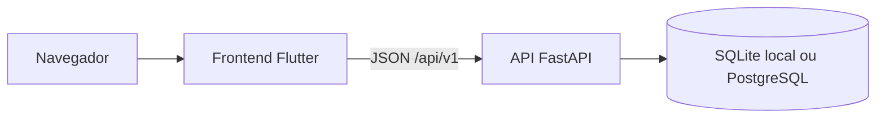

# TouchIn

Aplicação web para registro de ponto e gestão de equipes, com frontend Flutter e API FastAPI.

O TouchIn reúne registro e consulta de jornada, gestão de funcionários, projetos e tarefas, quadro Kanban e recursos administrativos.

## Arquitetura



## Tecnologias

- **Frontend:** Flutter e Dart; a CI usa o canal stable do Flutter.
- **Backend:** Python 3.12 na CI, FastAPI, SQLAlchemy e Pydantic.
- **Dados:** SQLite como padrão local; PostgreSQL com driver psycopg2.

## Início rápido

Os comandos a seguir usam macOS/Linux. Para PowerShell, veja [Desenvolvimento](docs/DEVELOPMENT.md).

```bash
cd backend
python3 -m venv .venv
source .venv/bin/activate
python3 -m pip install -r requirements.txt
cp .env.example .env
uvicorn app.main:app --reload --port 8071
```

Em outro terminal:

```bash
cd frontend
flutter pub get
flutter run -d web-server --web-port 8080
```

O app usa `http://localhost:8071/api/v1` por padrão em desenvolvimento. O `.env.example` contém valores de demonstração: substitua-os por segredos locais e nunca os reutilize fora de desenvolvimento. A API interativa fica em `http://127.0.0.1:8071/docs`.

## Documentação

- [Desenvolvimento, testes e POLIS](docs/DEVELOPMENT.md)
- [Deploy e configuração por ambiente](docs/DEPLOYMENT.md)
- [API, configuração do backend e permissões](backend/README.md)
- [Contexto e arquitetura do projeto](CONTEXT.md)
- [Formato do documento de contexto](CONTEXT-FORMAT.md)
- [Auditoria de acessibilidade — issue #64](docs/accessibility-issue-64.md)
- [Relatório de validação de performance](docs/performance/VALIDATION_REPORT.md)
- [Workflow de CI](.github/workflows/ci.yml)

Os arquivos em `docs/contracts/` registram contratos POLIS versionados; `docs/performance/` também contém scripts de análise. Relatórios de issue e validação são evidências datadas, não substituem a configuração ou o código atual.

## Licença

Uso proprietário. Consulte o repositório ou o time responsável para detalhes de distribuição. O repositório não contém um arquivo `LICENSE`.
