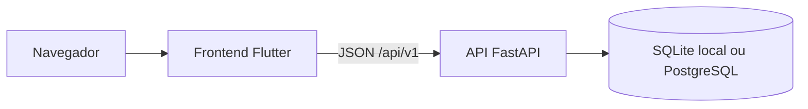

# TouchIn

Aplicação web para registro de jornada e gestão de equipes. O TouchIn reúne
registro de ponto com política de localização por funcionário, projetos e
tarefas, Kanban/backlog e trilha de auditoria. Veja os [fluxos do produto](docs/PRODUCT.md).

## Arquitetura



O CI usa Python 3.12 para FastAPI, SQLAlchemy e Pydantic, e Flutter/Dart
para a interface. Versões e ferramentas estão no [guia de desenvolvimento](docs/DEVELOPMENT.md).

## Início rápido

Para explorar a interface **sem backend, banco ou conta**, use a
[prévia offline](docs/DEVELOPER_PREVIEW.md). Para rodar o app normal,
siga os passos abaixo (macOS/Linux; no Windows, veja o
[guia para PowerShell](docs/DEVELOPMENT.md#preparar-o-backend)).

```bash
cd backend
python3 -m venv .venv
source .venv/bin/activate
python -m pip install -r requirements.txt
cp .env.example .env
# Edite .env antes de iniciar: use dois segredos locais distintos e uma senha de seed própria.
python -m uvicorn app.main:app --reload --port 8071
```

Em outro terminal, a partir da raiz do repositório:

```bash
cd frontend
flutter pub get
flutter run -d web-server --web-port 8080
```

Abra `http://localhost:8080`. O frontend abre no modo normal e aponta para
`http://localhost:8071/api/v1` por padrão. A API interativa fica em
`http://127.0.0.1:8071/docs`.

## Documentação

- [Índice da documentação](docs/README.md)
- [Desenvolvimento, testes e POLIS](docs/DEVELOPMENT.md)
- [Deploy e configuração por ambiente](docs/DEPLOYMENT.md)
- [API, configuração do backend e permissões](backend/README.md)
- [Contexto e arquitetura do projeto](CONTEXT.md)

## Licença

O repositório não contém um arquivo `LICENSE` para o projeto. Consulte os
responsáveis antes de reutilizar ou redistribuir o código. Atribuições de
recursos de terceiros são mantidas junto a esses recursos.
